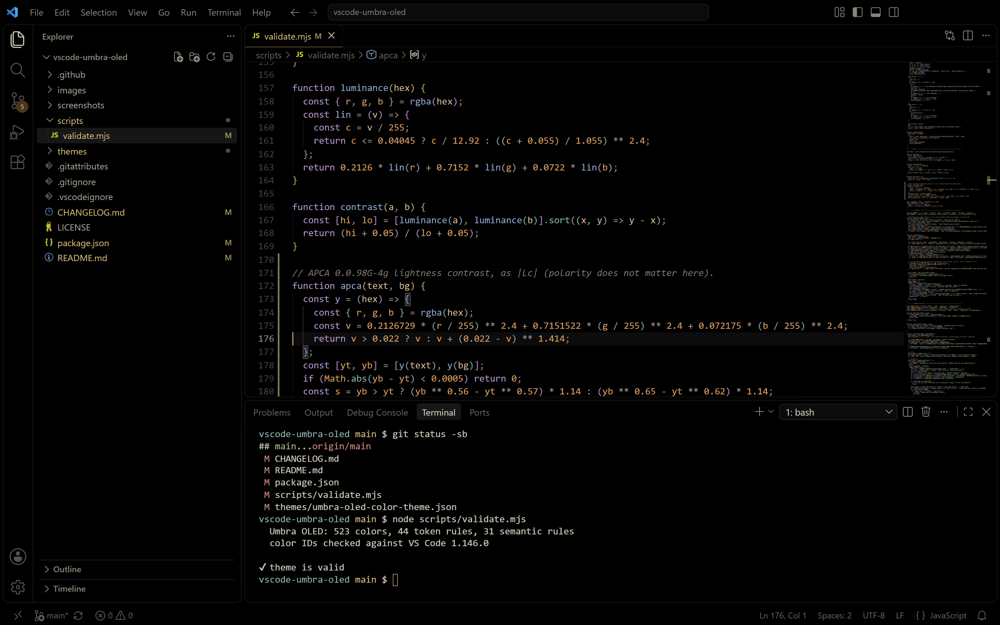
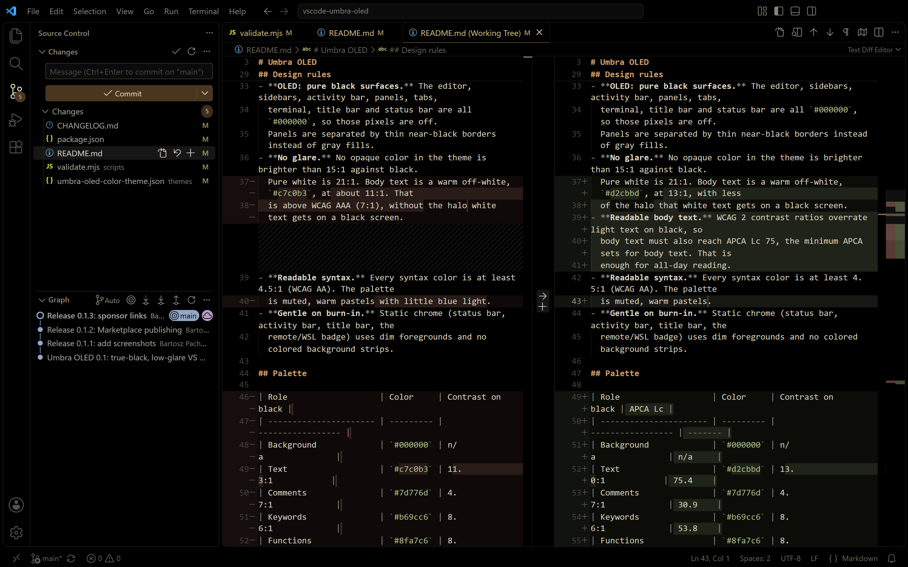
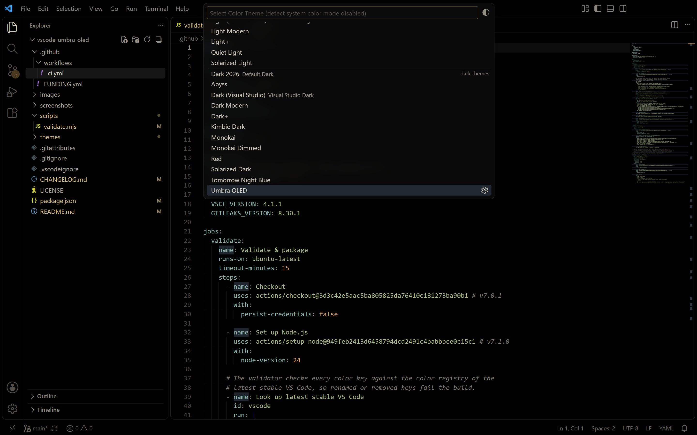

<a href="https://idct.tech"></a>

# Umbra OLED

[![Made in the EU](https://img.shields.io/badge/-Made%20in%20the%20EU-555?logo=data%3Aimage%2Fsvg%2Bxml%3Bbase64%2CPHN2ZyB4bWxucz0iaHR0cDovL3d3dy53My5vcmcvMjAwMC9zdmciIHZpZXdCb3g9IjAgMCA1MTIgNTEyIj48cmVjdCB3aWR0aD0iNTEyIiBoZWlnaHQ9IjUxMiIgZmlsbD0iIzAwMzM5OSIvPjxwb2x5Z29uIHBvaW50cz0iMjU2LjAwLDUyLjAwIDI2My42Myw3NS40OSAyODguMzQsNzUuNDkgMjY4LjM1LDkwLjAxIDI3NS45OCwxMTMuNTEgMjU2LjAwLDk4Ljk5IDIzNi4wMiwxMTMuNTEgMjQzLjY1LDkwLjAxIDIyMy42Niw3NS40OSAyNDguMzcsNzUuNDkiIGZpbGw9IiNGRkNDMDAiLz48cG9seWdvbiBwb2ludHM9IjM0MS4wMCw3NC43OCAzNDguNjMsOTguMjcgMzczLjM0LDk4LjI3IDM1My4zNSwxMTIuNzkgMzYwLjk4LDEzNi4yOCAzNDEuMDAsMTIxLjc2IDMyMS4wMiwxMzYuMjggMzI4LjY1LDExMi43OSAzMDguNjYsOTguMjcgMzMzLjM3LDk4LjI3IiBmaWxsPSIjRkZDQzAwIi8%2BPHBvbHlnb24gcG9pbnRzPSI0MDMuMjIsMTM3LjAwIDQxMC44NiwxNjAuNDkgNDM1LjU2LDE2MC40OSA0MTUuNTgsMTc1LjAxIDQyMy4yMSwxOTguNTEgNDAzLjIyLDE4My45OSAzODMuMjQsMTk4LjUxIDM5MC44NywxNzUuMDEgMzcwLjg5LDE2MC40OSAzOTUuNTksMTYwLjQ5IiBmaWxsPSIjRkZDQzAwIi8%2BPHBvbHlnb24gcG9pbnRzPSI0MjYuMDAsMjIyLjAwIDQzMy42MywyNDUuNDkgNDU4LjM0LDI0NS40OSA0MzguMzUsMjYwLjAxIDQ0NS45OCwyODMuNTEgNDI2LjAwLDI2OC45OSA0MDYuMDIsMjgzLjUxIDQxMy42NSwyNjAuMDEgMzkzLjY2LDI0NS40OSA0MTguMzcsMjQ1LjQ5IiBmaWxsPSIjRkZDQzAwIi8%2BPHBvbHlnb24gcG9pbnRzPSI0MDMuMjIsMzA3LjAwIDQxMC44NiwzMzAuNDkgNDM1LjU2LDMzMC40OSA0MTUuNTgsMzQ1LjAxIDQyMy4yMSwzNjguNTEgNDAzLjIyLDM1My45OSAzODMuMjQsMzY4LjUxIDM5MC44NywzNDUuMDEgMzcwLjg5LDMzMC40OSAzOTUuNTksMzMwLjQ5IiBmaWxsPSIjRkZDQzAwIi8%2BPHBvbHlnb24gcG9pbnRzPSIzNDEuMDAsMzY5LjIyIDM0OC42MywzOTIuNzIgMzczLjM0LDM5Mi43MiAzNTMuMzUsNDA3LjI0IDM2MC45OCw0MzAuNzMgMzQxLjAwLDQxNi4yMSAzMjEuMDIsNDMwLjczIDMyOC42NSw0MDcuMjQgMzA4LjY2LDM5Mi43MiAzMzMuMzcsMzkyLjcyIiBmaWxsPSIjRkZDQzAwIi8%2BPHBvbHlnb24gcG9pbnRzPSIyNTYuMDAsMzkyLjAwIDI2My42Myw0MTUuNDkgMjg4LjM0LDQxNS40OSAyNjguMzUsNDMwLjAxIDI3NS45OCw0NTMuNTEgMjU2LjAwLDQzOC45OSAyMzYuMDIsNDUzLjUxIDI0My42NSw0MzAuMDEgMjIzLjY2LDQxNS40OSAyNDguMzcsNDE1LjQ5IiBmaWxsPSIjRkZDQzAwIi8%2BPHBvbHlnb24gcG9pbnRzPSIxNzEuMDAsMzY5LjIyIDE3OC42MywzOTIuNzIgMjAzLjM0LDM5Mi43MiAxODMuMzUsNDA3LjI0IDE5MC45OCw0MzAuNzMgMTcxLjAwLDQxNi4yMSAxNTEuMDIsNDMwLjczIDE1OC42NSw0MDcuMjQgMTM4LjY2LDM5Mi43MiAxNjMuMzcsMzkyLjcyIiBmaWxsPSIjRkZDQzAwIi8%2BPHBvbHlnb24gcG9pbnRzPSIxMDguNzgsMzA3LjAwIDExNi40MSwzMzAuNDkgMTQxLjExLDMzMC40OSAxMjEuMTMsMzQ1LjAxIDEyOC43NiwzNjguNTEgMTA4Ljc4LDM1My45OSA4OC43OSwzNjguNTEgOTYuNDIsMzQ1LjAxIDc2LjQ0LDMzMC40OSAxMDEuMTQsMzMwLjQ5IiBmaWxsPSIjRkZDQzAwIi8%2BPHBvbHlnb24gcG9pbnRzPSI4Ni4wMCwyMjIuMDAgOTMuNjMsMjQ1LjQ5IDExOC4zNCwyNDUuNDkgOTguMzUsMjYwLjAxIDEwNS45OCwyODMuNTEgODYuMDAsMjY4Ljk5IDY2LjAyLDI4My41MSA3My42NSwyNjAuMDEgNTMuNjYsMjQ1LjQ5IDc4LjM3LDI0NS40OSIgZmlsbD0iI0ZGQ0MwMCIvPjxwb2x5Z29uIHBvaW50cz0iMTA4Ljc4LDEzNy4wMCAxMTYuNDEsMTYwLjQ5IDE0MS4xMSwxNjAuNDkgMTIxLjEzLDE3NS4wMSAxMjguNzYsMTk4LjUxIDEwOC43OCwxODMuOTkgODguNzksMTk4LjUxIDk2LjQyLDE3NS4wMSA3Ni40NCwxNjAuNDkgMTAxLjE0LDE2MC40OSIgZmlsbD0iI0ZGQ0MwMCIvPjxwb2x5Z29uIHBvaW50cz0iMTcxLjAwLDc0Ljc4IDE3OC42Myw5OC4yNyAyMDMuMzQsOTguMjcgMTgzLjM1LDExMi43OSAxOTAuOTgsMTM2LjI4IDE3MS4wMCwxMjEuNzYgMTUxLjAyLDEzNi4yOCAxNTguNjUsMTEyLjc5IDEzOC42Niw5OC4yNyAxNjMuMzcsOTguMjciIGZpbGw9IiNGRkNDMDAiLz48L3N2Zz4%3D&labelColor=003399)](https://github.com/ideaconnect/made-in-the-eu)
[](https://github.com/ideaconnect/vscode-umbra-oled/actions/workflows/ci.yml)
[](LICENSE)
[](https://github.com/sponsors/ideaconnect)
[](https://buymeacoffee.com/idct)

A true-black theme for Visual Studio Code, built for OLED screens and long sessions.
The pixels around your code stay off, and the code itself is in soft, warm colors
that don't glare.



## Screenshots

These screenshots show this repository open in Umbra OLED 0.2.0.

**Source Control and diff view.** The 0.2.0 changes, before they were committed:



**Theme picker.** **Preferences: Color Theme** opened over the CI workflow:



## Design rules

Each rule below is a hard limit, and [CI](#validation) fails the build if the theme breaks one.

- **OLED: pure black surfaces.** The editor, sidebars, activity bar, panels, tabs,
  terminal, title bar and status bar are all `#000000`, so those pixels are off.
  Panels are separated by thin near-black borders instead of gray fills.
- **No glare.** No opaque color in the theme is brighter than 15:1 against black.
  Pure white is 21:1. Body text is a warm off-white, `#d2cbbd`, at 13:1, with less
  of the halo that white text gets on a black screen.
- **Readable body text.** WCAG 2 contrast ratios overrate light text on black, so
  body text must also reach APCA Lc 75, the minimum APCA sets for body text. That is
  enough for all-day reading.
- **Readable syntax.** Every syntax color is at least 4.5:1 (WCAG AA). The palette
  is muted, warm pastels.
- **Gentle on burn-in.** Static chrome (status bar, activity bar, title bar, the
  remote/WSL badge) uses dim foregrounds and no colored background strips.

## Palette

| Role                   | Color     | Contrast on black | APCA Lc |
| ---------------------- | --------- | ----------------- | ------- |
| Background             | `#000000` | n/a               | n/a     |
| Text                   | `#d2cbbd` | 13.0:1            | 75.4    |
| Comments               | `#7d776d` | 4.7:1             | 30.9    |
| Keywords               | `#b69cc6` | 8.6:1             | 53.8    |
| Functions              | `#8fa7c6` | 8.5:1             | 53.5    |
| Types / classes        | `#d4bc82` | 11.3:1            | 67.6    |
| Strings                | `#a5ba88` | 10.0:1            | 61.1    |
| Numbers / constants    | `#d9a06e` | 9.2:1             | 57.2    |
| Properties / builtins  | `#88b5aa` | 9.2:1             | 57.3    |
| Parameters             | `#cdb99a` | 11.0:1            | 66.1    |
| Tags / `this` / errors | `#d68a80` | 7.8:1             | 49.8    |
| Accent                 | `#8a6c43` | n/a               | n/a     |

## Install

In VS Code, open the Extensions view (`Ctrl+Shift+X`), search for **Umbra OLED**, and
click **Install**. Or from a terminal:

```sh
code --install-extension IDCTpl.umbra-oled-theme
```

The listing is on the
[Visual Studio Marketplace](https://marketplace.visualstudio.com/items?itemName=IDCTpl.umbra-oled-theme).

Each [release](https://github.com/ideaconnect/vscode-umbra-oled/releases) also has the
`.vsix` attached, for installing a specific version or without the Marketplace:

```sh
code --install-extension umbra-oled-theme-<version>.vsix
```

Or build it from source:

```sh
git clone https://github.com/ideaconnect/vscode-umbra-oled.git
cd vscode-umbra-oled
npm run package          # creates umbra-oled-theme-<version>.vsix
code --install-extension umbra-oled-theme-*.vsix
```

Every CI run also uploads the packaged `.vsix` as a build artifact.

Then pick the theme with **Preferences: Color Theme** (`Ctrl+K Ctrl+T`), or set it
in `settings.json`:

```jsonc
{
  "workbench.colorTheme": "Umbra OLED",
  // keeps the theme if "window.autoDetectColorScheme" is turned on
  "workbench.preferredDarkColorTheme": "Umbra OLED"
}
```

### Remote windows (WSL, SSH, Dev Containers)

A color theme is a UI extension, so it runs on your local machine. Install it
locally once, and it applies to remote windows as well. You don't need to install
it on the remote host.

### Profiles

Extensions and settings are per profile. To use the theme in another profile,
install it there too:

```sh
code --install-extension IDCTpl.umbra-oled-theme --profile "My Profile"
```

## Tips

- **Smearing when scrolling?** On some OLED panels, pixels that are fully off take
  a moment to turn on, which leaves a faint trail behind moving text. If you notice
  it, set `editor.background` to `#050505` through `workbench.colorCustomizations`.
  You keep nearly all the power and burn-in benefit.

## Validation

`scripts/validate.mjs` is a dependency-free Node script (Node 18+) that checks:

1. **Manifest:** required fields, semver, theme contributions. On a tag build it
   also checks that the tag matches the version (`0.1` matches `0.1.0`).
2. **Theme structure:** strict JSON with no duplicate keys, well-formed colors,
   valid token rules (scopes, settings, font styles, and no scope styled twice),
   and valid semantic token selectors.
3. **Color IDs:** every key in `colors` is a real VS Code color. This step needs a
   VS Code install.
4. **Design rules:** the OLED, glare and readability limits above, including the
   APCA check for body text.

```sh
npm run validate
# add color ID checks against a local VS Code install:
node scripts/validate.mjs --vscode-app "/path/to/VS Code/resources/app"
```

[CI](.github/workflows/ci.yml) runs on every push, pull request and tag. It:

- downloads the latest stable VS Code and verifies its SHA-256, so the color IDs
  are checked against the current release
- runs the validator
- packages the `.vsix` with `vsce`
- scans the full git history for leaked secrets with
  [gitleaks](https://github.com/gitleaks/gitleaks)
- on a version tag, publishes that exact `.vsix` to the Marketplace once a
  maintainer approves the `marketplace` environment

Publishing uses the Marketplace's
[Trusted Publishing](https://code.visualstudio.com/api/working-with-extensions/publishing-extension):
GitHub gives the job a short-lived identity token, so no Marketplace token is
stored in the repository or in GitHub secrets.

All third-party actions are pinned to commit SHAs.

## Made in the EU

Umbra OLED is built in the European Union. The badge at the top comes from
[ideaconnect/made-in-the-eu](https://github.com/ideaconnect/made-in-the-eu), a
shared badge that makes a project's European origin visible at a glance.

## License

Copyright © 2026 IDCT ([idct.tech](https://idct.tech)).

Licensed under the [European Union Public Licence v. 1.2](LICENSE) (EUPL-1.2), or
any later version approved by the European Commission. You may not use this work
except in compliance with the Licence. The official text in all EU languages is at
<https://joinup.ec.europa.eu/collection/eupl/eupl-text-eupl-12>.

---

<div align="center">

### Free software runs on coffee ☕

Umbra OLED is free and open source. If it makes your screen easier on the eyes,
you can help keep it going.

<table>
<tr>
<td align="center" width="50%">
<a href="https://buymeacoffee.com/idct"></a>
<br>
<sub>☕ <b>One-off.</b> Buy a coffee whenever the theme saves your eyes.</sub>
</td>
<td align="center" width="50%">
<a href="https://github.com/sponsors/ideaconnect"></a>
<br>
<sub>💖 <b>Monthly.</b> Support ongoing work through GitHub Sponsors.</sub>
</td>
</tr>
</table>

</div>
